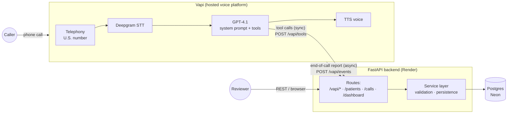

# Voice Patient Intake

A voice AI agent that registers new patients over the phone. A caller dials a real U.S. number, talks to "Alex", an AI intake coordinator, and gives their demographics in natural conversation. The agent validates each detail, reads everything back for confirmation, saves the record to Postgres, and ends the call. A REST API and a small dashboard expose the stored records.

## Live demo

| | |
|---|---|
| **Phone number** | **+1 (628) 258-5255** |
| **API base URL** | https://voice-patient-intake.onrender.com |
| **Dashboard** | https://voice-patient-intake.onrender.com/dashboard |
| **Interactive API docs** | https://voice-patient-intake.onrender.com/docs |

### Notes for testers

- **Returning-caller demo:** the database is seeded with *Jane Doe*, phone **512-555-0142**, DOB **03/14/1985**. Give that phone number during a call and the agent will offer to update Jane's record instead of creating a duplicate. It asks you to say her date of birth before changing anything.
- **"Use this number":** on a real phone call the agent reads back your caller ID. On a browser test call (Vapi dashboard) there is no caller ID, so the agent will ask you to say the digits.
- **Data is fictional.** Don't use real patient information.
- The backend runs on Render's free tier with a keep-alive ping every 10 minutes. If the very first request of the day is slow, that's a cold start.

---

## What it does

- Collects all 9 required fields and offers the 7 optional ones in a single opt-in question, as the spec suggests.
- Validates every detail on the server. Invalid input (a future birth date, a 3-digit phone number, a fake state, a bad ZIP) makes the agent re-ask for **that field only**.
- Handles corrections at any point ("actually it's S-A-R-A, no H"), out-of-order answers, and "can we start over?".
- Reads everything back in three short groups and saves only after an explicit "yes".
- Recognises returning callers by phone number and offers to update their record (bonus).
- Stores a transcript of every call, linked to the patient it created or updated (bonus).
- Says a spoken apology and offers a retry if the database write fails. The caller never gets silence or a false "you're all set".
- Ends the call itself after confirming success.
- REST API with filtering, partial updates and soft delete, all with a consistent `{data, error}` envelope.
- Dashboard listing patients, their details, and recent calls with transcripts (bonus).
- 44 automated tests covering the API and the voice webhooks against real Postgres (bonus).

---

## Architecture



### Separation of concerns

| Layer | Owner | Responsibility |
|---|---|---|
| Telephony, speech-to-text, text-to-speech, turn-taking, interruptions | **Vapi** | Real-time audio. The backend never handles audio. |
| Conversation logic | **LLM inside Vapi**, driven by `prompts/system_prompt.md` | What to ask, how to phrase it, when to call a tool |
| Business rules and validation | **FastAPI service layer** | One set of validators used by both the voice tools and the REST API |
| Persistence | **Postgres** | Typed columns, CHECK constraints as a final backstop |

**The backend is a tool server, not an AI service.** Vapi runs the agent loop (listen → think → speak). When the LLM needs the backend, it calls a tool, and Vapi POSTs that call to `/vapi/tools`, waits for the result, and hands it back to the LLM. The backend holds no conversation state; each request carries the call ID and caller number it needs.

### One call, end to end

1. The caller dials the number. Vapi answers with the assistant's `firstMessage`, spoken instantly without involving the LLM.
2. Deepgram transcribes the caller in real time, and the LLM decides the next turn.
3. After the caller gives a date of birth, phone, ZIP, or email, the LLM calls **`validate_field`**. The backend runs the same validator the REST API uses, and returns either a normalised value plus a spoken form ("March 4, 1990"), or a plain-English error the agent reads out.
4. When the phone number validates, the backend **also checks for an existing patient** with that number and returns any match in the same response. The agent then offers to update instead of registering again. (See *Design decisions* below for why this lives on the server.)
5. After the read-back and a "yes", the LLM calls **`save_patient`** (or **`update_patient`** for a returning caller). The backend validates again, writes the row, links the call ID to the patient, and returns `{success, patient_id, first_name}`.
6. The agent says "You're all set, [first name]" and calls Vapi's built-in **`endCall`**.
7. After hang-up, Vapi sends the **end-of-call report** to `/vapi/events`. The backend stores the transcript and the reason the call ended in `call_logs`, linked to the patient. This also happens for calls that drop before saving.

---

## Repository map: what each file does and how they connect

```
.
├── app/
│   ├── main.py               App entry point: logging, startup (create tables, seed), routers, /, /dashboard, /health, /ping
│   ├── config.py             Settings from environment variables (pydantic-settings)
│   ├── db.py                 SQLAlchemy engine, session factory, get_db() dependency
│   ├── models.py             Tables: patients (with CHECK constraints and indexes) and call_logs
│   ├── validators.py         Field rules: names, DOB, sex, phone, email, state, ZIP, member ID; normalisation; spoken errors
│   ├── schemas.py            Pydantic models PatientCreate / PatientUpdate / PatientOut; every field runs through validators.py
│   ├── errors.py             The {data, error} envelope and exception handlers (400/404/422/500)
│   ├── seed.py               Two demo patients, inserted only into an empty table
│   ├── routes/
│   │   ├── patients.py       REST: GET/POST /patients, GET/PUT/DELETE /patients/{id}
│   │   ├── calls.py          GET /calls (recent calls) and GET /patients/{id}/calls (transcripts)
│   │   └── vapi.py           Vapi webhooks: secret check, /vapi/tools dispatcher, /vapi/events end-of-call storage
│   ├── services/
│   │   ├── patients.py       Patient CRUD; called by BOTH the REST routes and the voice tools
│   │   ├── agent_tools.py    The four tools: lookup_patient, validate_field, save_patient, update_patient
│   │   └── calls.py          call_logs writes and reads
│   └── static/
│       └── dashboard.html    Self-contained dashboard page that reads the REST API
├── prompts/
│   └── system_prompt.md      The agent's system prompt, with engineer-facing comments explaining each section
├── vapi/
│   └── assistant.json        The full Vapi assistant: model, voice, transcriber, tool schemas, webhook URLs, timeouts
├── scripts/
│   └── sync_assistant.py     Builds the assistant from the two files above plus .env, and creates or updates it via Vapi's API
├── tests/
│   ├── conftest.py           Fresh tables per test against a real Postgres
│   ├── test_patients_api.py  REST behaviour, validation, soft delete, DB-level constraints
│   └── test_vapi_webhooks.py Simulated Vapi payloads: tools, returning callers, failures, end-of-call reports, dashboard
├── docker-compose.yml        Local Postgres for development and tests
├── Procfile                  Start command for PaaS hosts
├── requirements.txt
└── .env.example              Every environment variable, documented
```

**How a voice tool call flows through the files:**
`routes/vapi.py` checks the secret, reads `message.toolCallList`, and dispatches by tool name → `services/agent_tools.py` builds a `schemas.PatientCreate` (which runs `validators.py`) → `services/patients.py` writes through `models.Patient` → Postgres. The result is JSON-encoded back into Vapi's `{"results": [{"toolCallId", "result"}]}` format.

**How a REST call flows:**
`routes/patients.py` → the same `schemas.py` → the same `services/patients.py`. Errors from any layer are shaped by `errors.py`.

**How the agent definition flows:**
`prompts/system_prompt.md` + `vapi/assistant.json` + `.env` (URL, secret) → `scripts/sync_assistant.py` → Vapi's API. The repo is the source of truth for the agent; the Vapi dashboard is used for testing and call logs, not for editing.

---

## Tech stack and why

| Choice | Why |
|---|---|
| **Vapi** for telephony + voice | Provides the number, streaming STT/TTS, endpointing, barge-in and tool calling. Building that layer (Twilio + Deepgram + TTS + turn-taking) would consume the whole time box, and the spec encourages a platform. |
| **Vapi-hosted LLM (not a custom LLM endpoint)** | Vapi can also call your own OpenAI-compatible server for each turn. Hosting the agent loop in Vapi keeps latency low and the backend simple; a slow backend turn would become dead air. |
| **GPT-4.1** | Started with gpt-4o-mini. In testing it skipped tool calls and once invented a phone number. GPT-4.1 follows tool instructions reliably, and the LLM is a small fraction of per-call cost. |
| **Deepgram nova-3, `multi` language** | Fast, accurate phone transcription, with English/Spanish code-switching for the multilingual bonus. |
| **FastAPI + Pydantic** | Typed request validation, automatic OpenAPI docs at `/docs`, and fast to build. |
| **SQLAlchemy 2 + Postgres** | Real types (`DATE`, `UUID`, enum, `TIMESTAMPTZ`), CHECK constraints and regex rules in the database itself. |
| **Render** (web service) + **Neon** (Postgres) | Both free with no card. Railway was the first choice, but its sign-ups were disabled during a platform incident. Neon is used instead of Render's own Postgres because Render's free database expires after 30 days. |
| **cron-job.org** keep-alive | Render's free tier sleeps after 15 idle minutes. A cold start during a call would time out the first tool call, so `/ping` (which deliberately doesn't touch the database) is hit every 10 minutes. |

---

## Data model

`patients` matches the spec field-for-field.

| Column | Type | Enforced by |
|---|---|---|
| `patient_id` | UUID, primary key | Generated server-side |
| `first_name`, `last_name` | VARCHAR(50) | Letters (Unicode, so "José" works), spaces, hyphens, apostrophes |
| `date_of_birth` | DATE | Real date, not in the future, after 1900. Accepted as MM/DD/YYYY or ISO; returned as MM/DD/YYYY |
| `sex` | Postgres enum | Male, Female, Other, Decline to Answer |
| `phone_number`, `emergency_contact_phone` | VARCHAR(10) | Stored as 10 digits; a leading +1 is stripped; area codes can't start with 0 or 1 |
| `email` | VARCHAR(254) | Email format |
| `state` | CHAR(2) | Valid U.S. state or territory. "Texas" or "tx" is normalised to `TX` |
| `zip_code` | VARCHAR(10) | `12345` or `12345-6789` |
| `insurance_member_id` | VARCHAR(30) | Uppercase alphanumeric; spaces and dashes are stripped |
| `preferred_language` | VARCHAR(50) | Defaults to English |
| `created_at`, `updated_at`, `deleted_at` | TIMESTAMPTZ (UTC) | Automatic; `updated_at` is bumped on every update |

Validation happens in **three layers**: the voice agent checks values mid-call (for user experience), Pydantic validates every write on the server (the real guarantee), and Postgres CHECK constraints reject bad rows even if a future code path skips Pydantic. A test inserts an invalid row with raw SQL to prove the last layer works.

**`phone_number` is indexed but deliberately not unique.** Family members often share a number, so the phone is used to find likely matches, not as an identity.

`call_logs` stores, per call: `call_id` (Vapi's ID), `patient_id` (nullable foreign key), caller number, `ended_reason`, summary, transcript, and the raw report as JSONB.

---

## REST API

Every response uses the envelope `{"data": ..., "error": null}` or `{"data": null, "error": {"code", "message", "details": [{"field", "message"}]}}`.

| Method | Endpoint | Notes |
|---|---|---|
| GET | `/patients` | Filters: `?last_name=` (case-insensitive), `?date_of_birth=` (MM/DD/YYYY or ISO), `?phone_number=` (any format). Also `limit`/`offset`. Excludes soft-deleted rows. |
| GET | `/patients/{id}` | 404 if missing or deleted; 422 if the ID isn't a UUID |
| POST | `/patients` | 201 with the created record. Unknown fields are rejected. |
| PUT | `/patients/{id}` | Partial update: only the fields sent are changed. Required fields can't be cleared. |
| DELETE | `/patients/{id}` | Soft delete: sets `deleted_at`, keeps the row |
| GET | `/patients/{id}/calls` | Transcripts and outcomes of calls linked to the patient |
| GET | `/calls` | Most recent calls, including ones that never saved a patient |
| GET | `/health` | Checks the database connection |
| GET | `/ping` | Liveness only; no database access (used by the keep-alive) |
| POST | `/vapi/tools`, `/vapi/events` | Vapi webhooks; require the shared secret |

Status codes: 200, 201, 400 (malformed JSON), 401 (bad webhook secret), 404, 422 (validation, with per-field details), 500 (always inside the envelope).

Quick checks:

```bash
curl https://voice-patient-intake.onrender.com/patients
curl "https://voice-patient-intake.onrender.com/patients?phone_number=512-555-0142"
curl -X POST https://voice-patient-intake.onrender.com/patients -H 'content-type: application/json' \
  -d '{"first_name":"Ana","last_name":"Lopez","date_of_birth":"02/10/1990","sex":"Female","phone_number":"2125550111","address_line_1":"1 Main St","city":"New York","state":"NY","zip_code":"10001"}'
```

---

## Voice agent design

The prompt lives in **`prompts/system_prompt.md`**. HTML comments in that file explain each section for engineers and are stripped before the prompt is sent to Vapi. The highlights:

- **Voice-first style rules.** One or two short sentences per turn, one question at a time, no lists or symbols (everything is spoken), names spelled back letter by letter, phone numbers read in groups, zeros said as "zero".
- **Slot-filling, not a script.** Required fields are a checklist. If the caller says "I'm John Smith, born March 3rd 1985" in one breath, both answers are captured and not asked again.
- **Injected context.** Today's date (so the model can judge a birth date), and the caller ID with an explicit `NOT AVAILABLE` fallback. Without that fallback, the model filled the empty slot with a made-up number during testing.
- **Confirmation in three groups** (identity, contact and address, optional details), and saving only after a clear "yes".
- **Explicit handling of tool results:** what to say on success, on a validation error (re-ask only that field), and on a system error (apologise, offer one retry, and never claim success).
- **Corrections, start-over, Spanish switching, and boundaries** (no medical advice; tell the caller to hang up and call 911 in an emergency).

### Tools

| Tool | Purpose | Returns |
|---|---|---|
| `validate_field` | Check one value right after the caller says it | `valid`, `normalized`, `say_back`, or an `error` to read aloud. For a phone number, also `existing_patients` if any match. |
| `lookup_patient` | Look up a phone number on demand | Matches with name and the DOB to verify against |
| `save_patient` | Create the record after confirmation | `success` + `patient_id`, or field-level `errors`, or a `system` error |
| `update_patient` | Change only the confirmed fields of an existing record | `success` + `updated_fields` |
| `endCall` | Vapi built-in hang-up | — |

### Design decisions

- **Tool results tell the model what to do next.** A failed save returns errors keyed by field plus an instruction like "ask the caller to correct only these fields". That turns a generic failure into a targeted re-prompt.
- **Must-happen logic lives on the server, not in the prompt.** Two different models sometimes skipped the separate `lookup_patient` call. The returning-caller check now also runs inside `validate_field` for phone numbers, which the model calls reliably, so duplicate detection doesn't depend on the model remembering a step.
- **Saves are idempotent per call.** If the LLM calls `save_patient` twice in one call (a retry after a slow response, or a late correction), the second call updates the same record instead of creating a duplicate.
- **The stored DOB is never read aloud.** For a returning caller, the caller must state their date of birth, and the agent compares it.
- **Updating a street address clears a stale apartment line** unless a new one is given.
- **Webhook responses are always HTTP 200.** Vapi ignores other status codes, so any exception inside a tool is caught and returned as a speakable error.

---

## Edge cases and resilience

| Scenario | Behaviour |
|---|---|
| Invalid DOB (future, Feb 30, before 1900) | `validate_field` rejects it with a spoken reason; agent re-asks only the DOB. `save_patient` re-validates regardless. |
| 3-digit or otherwise invalid phone | Same: "Phone number must be a 10-digit U.S. number; I got 3 digits." |
| Caller corrects a field mid-call | Only that field changes; the agent confirms it briefly and continues |
| Answers out of order | Captured and not asked again |
| Caller wants to start over | Agent clears everything and restarts from the name |
| Call drops mid-way | Nothing is saved, because saving only happens after confirmation, so there are no partial records. The end-of-call report is still stored with its `ended_reason` and partial transcript (visible in `/calls` and the dashboard). |
| Database write fails | The tool returns a `system` error; the agent apologises, says the information wasn't saved, and offers one retry. Covered by a test that simulates the database being down. |
| LLM retries a save | Idempotent per call; no duplicate record |
| Returning caller | Recognised by phone; identity verified by DOB; only the changed fields are updated |
| Caller says "this number" with no caller ID | Agent says it can't see the number and asks for the digits; it never invents one |
| Silence | One "Are you still there?" prompt; Vapi ends the call after 30 seconds of silence |
| Forged webhook request | 401 without the shared secret |

---

## Observability

- Every tool call is logged to stdout with its call ID, payload and result, including the final `save_patient` payload, as the spec requires. These appear in Render's log viewer.
- Every call's transcript and end reason are stored in `call_logs` and shown on the dashboard.
- Vapi's call logs show per-turn latency and each tool request and response.

---

## Security

- No secrets in source. Everything comes from environment variables; `.env` is gitignored.
- Vapi webhooks require a shared secret, compared in constant time. Both `Authorization: Bearer <secret>` and `X-Vapi-Secret` are accepted.
- All API input is validated server-side; unknown fields are rejected; the ORM parameterises every query.
- The dashboard inserts all caller-supplied text with `textContent`, so a name like `<script>` can't execute.

---

## Running locally

Requirements: Python 3.12, Docker.

```bash
git clone https://github.com/aqib420/voice-patient-intake.git
cd voice-patient-intake
cp .env.example .env
python -m venv .venv && source .venv/bin/activate
pip install -r requirements.txt

docker compose up -d
docker compose exec db createdb -U postgres patients_test

pytest -q
uvicorn app.main:app --reload
```

Then open http://localhost:8000/dashboard or http://localhost:8000/docs. Tables are created and seed data inserted on first start.

### Connecting a voice agent

Vapi must reach the backend over public HTTPS, so deploy it (or use a tunnel such as ngrok), then:

1. Set `PUBLIC_BASE_URL`, `VAPI_API_KEY` and `VAPI_WEBHOOK_SECRET` in `.env`. The secret must match the deployed backend's.
2. Run `python scripts/sync_assistant.py --dry-run` to preview the config, then `python scripts/sync_assistant.py` to create the assistant. Add the printed `VAPI_ASSISTANT_ID` to `.env`; later runs update the same assistant.
3. In the Vapi dashboard, create a phone number and select the assistant under its inbound settings.

### Deploying (as done here)

- **Neon:** create a project and copy the direct (non-pooled) connection string.
- **Render:** create a web service from the repo. Build: `pip install -r requirements.txt`. Start: `uvicorn app.main:app --host 0.0.0.0 --port $PORT`. Set the environment variables below.
- **Keep-alive:** a cron job hitting `/ping` every 10 minutes.

---

## Environment variables

| Variable | Used by | Purpose |
|---|---|---|
| `DATABASE_URL` | Backend | Postgres connection string. `postgres://` and `postgresql://` are both accepted. |
| `VAPI_WEBHOOK_SECRET` | Backend + sync script | Shared secret Vapi sends with every webhook |
| `SEED_DATA` | Backend | `true` inserts two demo patients when the table is empty |
| `LOG_LEVEL` | Backend | Defaults to `INFO` |
| `PYTHON_VERSION` | Render | `3.12.8` |
| `VAPI_API_KEY` | Sync script only | Vapi private API key; never deployed |
| `PUBLIC_BASE_URL` | Sync script only | Public URL of the backend, used to build the tool and event URLs |
| `VAPI_ASSISTANT_ID` | Sync script only | Makes the script update the existing assistant instead of creating a new one |
| `TEST_DATABASE_URL` | Tests | Defaults to the local `patients_test` database |

---

## Known limitations and trade-offs

- **No authentication on the REST API or dashboard.** Fine for fictional data in an assessment, but real patient data would need auth, audit logging, and HIPAA-grade hosting.
- **Webhook auth is a shared secret, not a signed request.** Simple and adequate here; HMAC signatures with a timestamp would add replay protection.
- **Schema is created with `create_all`, not migrations.** Fine for a fresh database; a real service would use Alembic.
- **LLM behaviour isn't fully deterministic.** Critical rules (validation, duplicate detection, idempotent saves) are enforced on the server for that reason, but phrasing and pacing can still vary between calls.
- **Browser test calls have no caller ID**, so "use this number" only works on real phone calls.
- **Call summaries are empty.** Transcripts are stored, but Vapi's post-call summary wasn't enabled in the assistant config.
- **Free-tier hosting.** Render sleeps without traffic (mitigated by the keep-alive), and Neon's compute pauses after 5 idle minutes (the app reconnects automatically).
- **Spanish is lightly tested.** The prompt and transcriber support it, but the selected voice is optimised for English.
- **Appointment scheduling (bonus) isn't implemented.**

## Next steps

1. Enable Vapi's post-call summary and structured data extraction, and store them alongside the transcript.
2. Add API keys or OAuth to the REST API and dashboard.
3. Tune endpointing so the agent waits a little longer when a caller pauses mid-sentence, and add transcriber keywords for commonly misheard words ("male").
4. Add a multilingual voice and test the Spanish flow end to end.
5. Add appointment scheduling as another tool backed by mock availability.
6. Replace `create_all` with Alembic migrations, and run the tests in CI.
7. Build a small regression suite that replays recorded transcripts through Vapi's chat API, so prompt changes can be tested without phone calls.